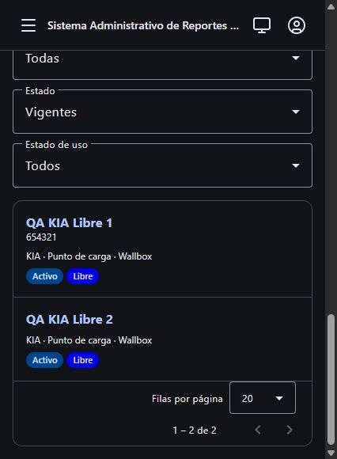

# Quickstart de validación — Feature 001

Guía para la implementación posterior; no acredita pruebas ejecutadas ahora.
Ejecutar desde la raíz del repositorio salvo indicación. Requiere JDK 25, Maven wrapper,
Node/npm compatibles con el proyecto y Docker activo con PostgreSQL 18 disponible.

## Seguridad del entorno

Usar Testcontainers de las pruebas existentes: base PostgreSQL desechable y FileStorage simulado.
No cargar datos de prueba en la instancia local del usuario ni usar sus credenciales reales.
Para validar por navegador, levantar una instancia y base exclusivas de QA con configuración
separada; no reutilizar el compose de desarrollo sin aislar sus datos. No ejecutar TRUNCATE
contra una base compartida. La preparación de ese entorno pertenece a implementación/validación.

## Comandos existentes

En sarc-bakend:
- .\mvnw.cmd test "-Dtest=EquipmentClassificationTest,EquipmentTest,InventoryApiTest,EquipmentImportApiTest"
- .\mvnw.cmd test "-Dtest=ConsumptionApiTest,ArchitectureTest"
- .\mvnw.cmd test "-Dtest=OpenApiContractTest" "-Dopenapi.update=true"
- .\mvnw.cmd test

En sarc-frontend, después de actualizar el contrato:
- npm.cmd run api:types
- npm.cmd test -- --watch=false
- npm.cmd run lint
- npm.cmd run build

La actualización OpenAPI y generación de tipos son escrituras de implementación: no se ejecutan
durante planificación. La prueba de contrato normal debe pasar también sin openapi.update.

## Matriz funcional a demostrar

| Caso | Resultado |
| --- | --- |
| FREE nuevo sin código, null, vacío o espacios | Alta aceptada y auditoría registrada |
| Dos FREE distintos sin código | Ambos aceptados; sin conflicto por ausencia |
| BLOCKED o DISCONNECTED sin código | Rechazo español; no alta ni modificación parcial |
| FREE con código inválido | Rechazo aunque el campo sea opcional |
| BLOCKED 654321 → FREE con campo omitido | Conserva 654321 y demás datos |
| FREE sin código → BLOCKED sin/con válido | Rechazo / aceptación respectivamente |
| FREE con código → BLOCKED sin reescribir código | Conservación y aceptación |
| Corrección explícita del código ya autorizada, sin cambiar uso | Conserva tratamiento previo, formato, unicidad y auditoría; no se ignora el valor nuevo por la protección automática |
| Duplicado activo/inactivo/eliminado | Rechazo por conflicto conforme al inventario |
| Dos altas simultáneas con el mismo código | Solo una se confirma; sin duplicación |
| Otras redes/electrolineras | Código por serie y restricciones previas intactas |

Repetir altas/transiciones por MockMvc sin pasar por Angular y mediante importación FILE/PASTE.
Probar validación tanto en preview como al confirmar; aprobación de modificación y reintento
conservan reglas existentes. Un rechazo por fila no redefine el resto de un lote.

## Cobertura concreta

- EquipmentClassificationTest: parametrizar red/tipo/uso y formato/ausencia. No eliminar los
  rechazos de BLOCKED/DISCONNECTED al ajustar el test antiguo de vacío.
- EquipmentTest: creación, applyDetails, draft y transiciones; comparar códigos y propiedades.
- InventoryApiTest: solicitudes directas, permisos, versiones, códigos propios/ajenos y reporte.
- EquipmentImportApiTest: sustituir fixture FREE sin código inválido por BLOCKED para mantener
  la intención; agregar FREE sin código válido y actualizar conteos de clasificación.
- Nuevas comprobaciones PostgreSQL: aplicar migración incremental y verificar el CHECK mediante
  inserciones inválidas, no solo dominio; comprobar códigos previos sin cambios.
- equipment-form.spec.ts y equipment-form-dialog.spec.ts: required/pattern reactivos, payload,
  valores precargados, omisión y conservación al alternar estados.
- OpenApiContractTest y compilación cliente: null publicado, sin diferencias manuales ocultas.

## Consumo, auditoría e historia

Crear en sandbox un KIA FREE sin código y registrar sesiones mediante claves válidas de origen.
Verificar vinculación por UUID/serie, mismos kWh/sesiones y reportes PDF/Excel generables.
Probar filtros, ranking y etiquetas sin “null”, sin duplicar ni perder vínculos.
Estas adaptaciones de lectura se verifican bajo la excepción acotada de FR-011: no cambian
conciliación, identidad, métricas, filtros, permisos ni archivos ya emitidos.

Comparar antes/después: UUID del equipo y conectores, sesiones, revisiones, identidades externas,
códigos anteriores y archivos archivados. Los campos normales de auditoría/versionado pueden
cambiar al editar; las demás propiedades no solicitadas no.
Alta manual e importada deben emitir auditoría aun sin código; no debe perderse el evento
por Map.of ni fallar el reporte por List.of.

## Cierre

Guardar evidencia de cada escenario de spec.md, de la matriz y de las suites. Un build verde
solo no prueba migración, historia ni reglas de importación. Revisar diff focalizado: nada de
cambios en V001–V007, métricas de consumo, UID/PUK, permisos o decisiones fuera de Feature 001.

## Evidencia de implementación

- Entorno: Testcontainers PostgreSQL 18, FileStorage simulado; sin conexión a base local.
- Frontend inicial: 21 archivos, 75 pruebas aprobadas.
- Hashes iniciales de migraciones aplicadas (SHA-256):

- `V001__init_roles_usuarios.sql`: `ccef1a4b1de3c7de5394d731b02890de9f35904d1fe0be33612fee54f278b0e3`
- `V002__auditoria.sql`: `74157c76512b7ec81b9fca18fea5473557693300ee065dd2bb6d5742138d5e00`
- `V003__spring_session.sql`: `aedaf7e519a92d39a29d8c42991224a65332bba6fe3c228d3b6d43233382a5dd`
- `V004__inventario_equipos.sql`: `774e8127c25f1ca0d790795a500fae2dd6837ab3f2db38b6fb221d43032a6a11`
- `V005__consumo_energia.sql`: `3e802a889d549b0945b891954cae7ca5139e0dc73232c167bc8d6182b5759059`
- `V006__importacion_equipos.sql`: `84b5dca7b89ea96a90f6061547ff446d50ab6b8aeecb171ea32cce2eca2f47a9`
- `V007__correcciones_qa.sql`: `1fb6d16792deed9249e7b6ce60382dbe02a7330e7f1e1097c35ba76e2f6a618a`

- Backend inicial: 161 pruebas aprobadas; `target/feature001-baseline.log`.
- T001–T002: aislamiento, gates e ignores verificados; no paquete publicable ni Terraform/Helm.

- Base: T003/T004 red confirmado (NOT NULL/contrato), V008 y contrato regenerado verdes; contrato sin update verde. US1: dominio/formulario red confirmado; creacion ausente, consultas, auditoria y PDF/XLSX verdes en la ejecucion feature001-us2-red.log. Configuracion JSON conserva null explicito solo en assignedCode.
- US2: feature001-us2-green.log: 41 pruebas backend verdes; formulario/conversion: 19 pruebas verdes. Omision/null/vacio/espacios conservan 654321; comparacion de conectores, identidad externa y datos de negocio intacta. Rechazos atomicos, correccion explicita, duplicado y version obsoleta comprobados.
- US3: feature001-us3-green.log: 20 pruebas verdes. Matriz FILE XLSX/PASTE, confirmacion, aprobacion, revalidacion tras preview y reintento sin duplicados; contrato nullable y 5 roles. Consumo: vinculos por serie e identidad Wallbox verificada, correccion con revision, 2 sesiones/20 kWh, PDF/XLSX y copias archivadas con SHA-256 conservadas tras BLOCKED/FREE. Evaluator/detailsOver ya reutilizan politica; sin cambio requerido.
- Cierre automatizado: carrera (feature001-race.log) 1 prueba verde; suite backend completa 184 pruebas, 0 fallos/errores/omitidas (feature001-full.log), incluidas ArchUnit/OpenAPI sin update. Angular: 21 archivos/87 pruebas, lint y build aprobados; build final sin advertencias tras corregir acceso opcional redundante. V001-V007 conservan SHA-256 original.

## Aceptación final en navegador — 29 de octubre de 2026

Instancia Spring Boot de prueba en puerto aleatorio, PostgreSQL 18 de Testcontainers y
FileStorage simulado. Angular en `127.0.0.1:4201` con proxy exclusivo generado dentro de
`sarc-bakend/target/`. Cuenta y equipos sintéticos, distintos del entorno habitual en localhost.

| Criterio | Comprobación observada | Resultado |
| --- | --- | --- |
| AC1 | Alta KIA LIBRE con código vacío: detalle y notificación «Equipo registrado». | PASS |
| AC2 | Alta KIA BLOQUEADO sin código: formulario permanece abierto y muestra «Ingrese el código asignado». Al elegir LIBRE se permite registrar. | PASS |
| AC3 | Edición BLOQUEADO `654321` → LIBRE: mismo UUID, código `654321` y datos precargados conservados. | PASS |
| AC4 | LIBRE sin código → BLOQUEADO: guardar rechazado; informar `654321` permite guardar. | PASS |

El fixture optativo `Feature001BrowserSandbox` comprobó al terminar exactamente dos equipos:
uno FREE con código NULL y otro FREE con `654321`. Resultado: 1 prueba, 0 fallos/errores.
Logs: `sarc-bakend/target/feature001-browser.log`. Captura persistente:

El proceso Angular, la pestaña temporal y el backend de QA fueron cerrados. Se comprobó que el
contenedor PostgreSQL usado por este recorrido ya no estaba en ejecución. No se importaron ni
eliminaron registros de la base local del usuario.

### Trazabilidad de los resultados medibles

| Resultado | Evidencia |
| --- | --- |
| SC-001 | Ausencia omitida/null/vacía/espacios y múltiples altas: EquipmentTest, InventoryApiTest, matriz FILE/PASTE y AC1 en navegador. |
| SC-002 | Obligatoriedad BLOCKED/DISCONNECTED, formato y duplicados: dominio, API, SQL directo, importación y AC2/AC4. |
| SC-003 | Conservación por omisión/null/vacío/espacios; conectores, horario e identidad externa: pruebas de edición y AC3 en navegador. |
| SC-004 | Mismos casos en formulario, POST/PUT, pegado y XLSX; política común en dominio, preview y confirmación. |
| SC-005 | Otras redes/tipos y permisos: suite completa/SQL. Consumo: UUID, 2 sesiones/20 kWh, revisiones y bytes/checksums de reportes anteriores intactos. |

### Repetir el recorrido aislado

1. En `sarc-bakend`, ejecutar `./mvnw.cmd test -Dtest=Feature001BrowserSandbox -Dsarc.qa.browser=true`.
2. Esperar `target/feature001-browser.ready` y `target/feature001-browser-proxy.json`.
3. En `sarc-frontend`, ejecutar `npm.cmd start -- --host 127.0.0.1 --port 4201 --proxy-config ../sarc-bakend/target/feature001-browser-proxy.json`.
4. Usar únicamente esa instancia con la cuenta sintética declarada en el fixture. Completar AC1–AC4;
   dejar los dos equipos finales descritos y crear `sarc-bakend/target/feature001-browser.done`.
5. El fixture comprueba la base y finaliza; cerrar Angular y la pestaña. Si no se señala el fin,
   el fixture falla a los 15 minutos y su base sigue siendo desechable.

### Entrega coordinada

V008 queda preparada para el próximo arranque del backend sobre cada entorno autorizado.
No requiere backfill ni cambios de códigos existentes. Backend y cliente nullable deben
entregarse juntos. No revertir a NOT NULL rellenando códigos ficticios.

- Revision final: 36/36 tareas completadas. Refuerzo final de conservacion con ubicacion/mapas/OCPP informados y edicion de nombre sin codigo: 2 pruebas verdes (feature001-history-final.log). Diff revisado contra plan/data-model/constitucion; sin nuevos endpoints, frameworks ni cambios de negocio RF-003. V001-V007: 7/7 hashes intactos. Hooks post-implement: no configurados.
