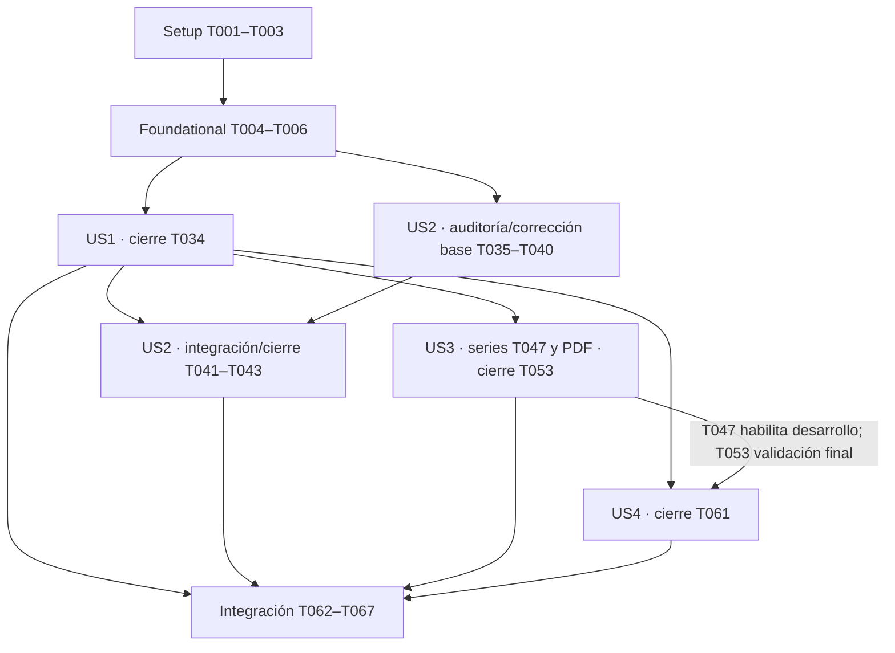

# Tasks: Visibilidad, UX/UI y reportes gerenciales

**Feature**: `004-visibilidad-ux-reportes` | **Fecha**: 2026-10-31.
**Input**: [spec.md](spec.md), [plan.md](plan.md), [research.md](research.md), [data-model.md](data-model.md), [contratos](contracts/api-ui-reporting.md), [quickstart.md](quickstart.md), [auditoría visual](visual-audit-plan.md) y constitución1.0.0.
**Estado**: en ejecución; las casillas marcadas tienen evidencia real en `evidence/`. Las abiertas siguen pendientes.
**Rama**: `main` sigue siendo la rama Git; selector Spec Kit004. Baseline del plan `7354d6e`, comprobar estado real en T001 sin alterar cambios ajenos.

**Tests**: incluidos porque spec exige verificación de permisos, archivos, auditoría responsive/AA y regresiones (SC-001–010), desarrollada en quickstart. Escribir primero las pruebas nuevas y comprobar el fallo esperado por comportamiento/contrato, no por acceso a BD dev o herramientas mal configuradas; ejecutar su gate al completar implementación. No sustituir suites002/003 ni sus reglas.

**Formato**: `- [ ] Tnnn [P?] [USn?] Acción y ruta`. IDs en orden, todas las rutas relativas al repositorio (grafía real `sarc-bakend`). [P] significa archivos diferentes y prerrequisitos de fase ya satisfechos; las dependencias individuales también deben estar completas. Si la tarea define archivo nuevo, crearlo durante implementación, no asumir que ya existe.

**Límites**: conservar estado oficial, umbral revisable, HALF_UP por lectura, idempotencia, históricos, nombres vigentes, mes operativo y todos los empates. Migración nueva solamente. Sin rediseño general, roles nuevos, cambios de edición, ECharts/MapStruct/Spring Batch añadidos por conveniencia ni dependencias de producción nuevas sin justificación. Sin datos ficticios fuera del sandbox.

## Phase 1: Setup — preparación del trabajo

**Objetivo**: Registrar la base y los medios de validación. Reutilizar proyecto existente; no inicializar frameworks ni cambiar stack.

- [X] T001 [P] Registrar baseline real, versiones, hashes V001–V010, suites001–003 y tamaños/tiempos actuales siguiendo quickstart en `specs/004-visibilidad-ux-reportes/evidence/baseline.md`; no iniciar dev ni declarar resultados sin ejecución. (FR-005, FR-022, SC-009, SC-010).
- [X] T002 [P] Crear inventario ejecutable de rutas/diálogos/estados y matriz360/390/768/1024/1440 × claro/oscuro desde visual-audit-plan en `specs/004-visibilidad-ux-reportes/evidence/visual-matrix.md`, con roles, viewport completo, N/A justificados y vínculo de cada futuro hallazgo a captura antes/después. (FR-011, FR-012, FR-013, SC-005).
- [X] T003 [P] Registrar disponibilidad y método de navegador, Impeccable, contraste/lectura asistida, proveedor QA y Excel Windows en `specs/004-visibilidad-ux-reportes/evidence/qa-environment.md`; conservar Chart.js/OpenPDF/POI y distinguir herramientas ya disponibles de cualquier dependencia QA adicional justificada. Preparar runner sin dependencia de producción en `sarc-bakend/src/test/resources/qa/feature004-performance.mjs` para repetir carga30 concurrentes y guardar métricas sin credenciales. (FR-014, FR-015, FR-020, FR-022).

## Phase 2: Foundational — sandbox y regresiones compartidas

**Objetivo**: Preparar datos/puertos/almacenamiento desechables y baseline verificable. Completar T004–T006 antes de implementar una historia; sin tocar BD dev.

- [X] T004 Crear datos reutilizables únicamente de test en `sarc-bakend/src/test/java/com/tidsec/sarc_bakend/support/Feature004Fixtures.java`: cinco roles/multirol, cinco categorías, aprobada oficial con rechazo previo, nulo/0, ambos proveedores, empates/nombres largos/366 días y originales CONSUMPTION/INVENTORY con hash/fechas preservables; claves sintéticas sin tocar archivos del usuario. Incluir perfil de carga250.000 registros/mes opt-in separado de las fixtures pequeñas de suites. (FR-005, SC-001, SC-009; Depende de T001).
- [X] T005 Crear fixture opt-in `sarc-bakend/src/test/java/com/tidsec/sarc_bakend/Feature004BrowserSandbox.java` con PostgreSQL18 @ServiceConnection, puerto aleatorio, Compose desactivado, cinco usuarios y FileStorage simulado que conserve bytes; generar ready/proxy/done en target/feature004-* y cerrar solo recursos propios. Probar que no utiliza BD/volumen/storage dev. (SC-001, SC-003, SC-004, SC-009; Depende de T004).
- [X] T006 Adaptar únicamente actor/helper de consultas operativas de regresiones002/003 en `sarc-bakend/src/test/java/com/tidsec/sarc_bakend/modules/consumption/api/ConsumptionApiTest.java` de manager a analyst/admin; conservar expectativas de negocio, idempotencia, ausentes/0, revisión, snapshot y archivo. Ejecutar esas regresiones aún sobre la base vigente y documentarlas en baseline.md. Antes de cambios de producto, ejecutar con T005 el runner T003 sobre la carga opt-in y registrar referencia comparable de consultas/dashboard y emisión en baseline.md. (FR-005, FR-006, SC-009; Depende de T004, T005, T003).

## Phase 3: User Story 1 — Consultar y exportar según el rol (P1) — MVP

**Objetivo**: Aplicar restricción completa en backend, consultas, UI, archivos y originales; nueva emisión gerencial diferenciada. Sin nuevas gráficas todavía.

**Prueba independiente**: Con datos oficiales y cinco categorías, recorrer cinco roles y combinaciones, consultas directas, paginación, revisión por UUID, PDF/XLSX y emitidos. Operadores conservan cinco categorías; gerenciales solo oficiales, incluidas excepciones aprobadas; originales/ID/hash/fechas intactos y nueva emisión con corte propio.

### Pruebas de la historia

- [X] T007 [P] [US1] Añadir pruebas de lectura y unión OR en `sarc-bakend/src/test/java/com/tidsec/sarc_bakend/shared/security/ConsumptionReadAccessTest.java`: todos los roles, Analista+Gerente, Admin+Asistente y combinación solo gerencial; usuario sin sesión/cambio obligatorio no obtiene capacidad operativa. (FR-001, FR-009, SC-001).
- [X] T008 [P] [US1] Añadir pruebas API en `sarc-bakend/src/test/java/com/tidsec/sarc_bakend/modules/consumption/api/ConsumptionVisibilityApiTest.java` para cinco propiedades omitidas frente a ceros, oficiales idénticos, paginación/count seguros, manipulación de state/energyReview/text/equipo y revisión por UUID:404 no oficial/inexistente, solo APPROVED vigente en oficial, nunca rechazo previo; conservar anónimo401 y edición403. (FR-001, FR-002, FR-004, FR-006, FR-009, SC-001, SC-002).
- [X] T009 [P] [US1] Añadir integración V010→V011 en `sarc-bakend/src/test/java/com/tidsec/sarc_bakend/modules/reporting/infrastructure/persistence/IssuedReportMetadataSchemaTest.java`: legado nullable, valores permitidos/coherencia JSON, ddl-auto=validate, constructor de inventario compatible, mismos ID/hash/ref/fechas y ninguna edición de V001–V010. (FR-005, FR-007, SC-003, SC-009).
- [X] T010 [P] [US1] Añadir `sarc-bakend/src/test/java/com/tidsec/sarc_bakend/modules/reporting/api/IssuedReportAccessApiTest.java` con matriz OFFICIAL_ONLY/WITH_OPERATIONS/consumo legado/inventario; autorización antes de leer storage, binario sin redirect/URL/fileRef, headers no-store,403 con acción,404 sin copia,503 por proveedor y revocación/cookie anterior; probar nuevo ID/corte sin sustituir original. (FR-003, FR-007, FR-008, FR-009, SC-003).
- [X] T011 [P] [US1] Añadir `sarc-bakend/src/test/java/com/tidsec/sarc_bakend/modules/consumption/infrastructure/report/ConsumptionReportPrivacyTest.java` para PDF y XLSX por audiencia: sin agregados/detalles restringidos en texto, hojas ocultas/veryHidden, sharedStrings, nombres definidos o soportes; operadores mantienen cinco categorías y todos conservan oficiales/justificación vigente. Verificar que informe gerencial no materializa excluidas. (FR-003, FR-004, FR-006, SC-001, SC-002).
- [X] T012 [P] [US1] Ampliar `sarc-frontend/src/app/features/consumption/presentation/dashboard-page/dashboard-page.spec.ts` y `sarc-frontend/src/app/features/consumption/presentation/sessions-page/sessions-page.spec.ts`: presencia/autorización de tarjeta, estados/filtros oficiales, evidencia aprobada, conservación de rutas y limpieza al perder sesión; ausencia operativa no se presenta como0. (FR-001, FR-002, FR-004, FR-009, SC-001).
- [X] T013 [P] [US1] Crear pruebas de binario, Blob ProblemDetail y flujo de nueva emisión en `sarc-frontend/src/app/features/reports/data-access/issued-reports-api.spec.ts`, `sarc-frontend/src/app/features/reports/application/issued-reports-facade.spec.ts` y `sarc-frontend/src/app/features/reports/presentation/issued-reports-page/issued-reports-page.spec.ts`; verificar que vista usa fachada y esta cliente propio de Reportes para GET /energy/report con parámetros permitidos, sin importar ConsumptionApi ni internos de Consumo; criterios legados confirmados, corte/ID nuevos, original intacto y descarga de inventario conservada. (FR-003, FR-007, FR-008, SC-003).

### Implementación y verificación de la historia

- [X] T014 [US1] Centralizar la pequeña política común de lectura en `sarc-bakend/src/main/java/com/tidsec/sarc_bakend/shared/security/ConsumptionReadAccess.java`, reutilizando CurrentActor.hasAnyRole y permisos existentes: «Usuario activo con ADMINISTRADOR o ANALISTA actuales; unión OR». Integrarla junto a ConsumptionPermissions sin crear roles ni alterar anotaciones de escritura. (FR-001, FR-005, FR-009; Depende de T007).
- [X] T015 [US1] Proyectar por audiencia `sarc-bakend/src/main/java/com/tidsec/sarc_bakend/modules/consumption/api/response/ConsumptionSummaryResponse.java` y conectarla en `sarc-bakend/src/main/java/com/tidsec/sarc_bakend/modules/consumption/api/controller/ConsumptionController.java`: omitir exactamente pendingLink/awaitingApproval/test/energyReview/energyRejected para gerenciales; operadores reciben cinco, incluso0. Conservar official y approvedAboveThreshold y documentar opcionalidad, sin tocar fórmulas. (FR-001, FR-002, FR-004, FR-006; Depende de T014, T008).
- [X] T016 [US1] Imponer en `sarc-bakend/src/main/java/com/tidsec/sarc_bakend/modules/consumption/application/service/SessionQueryService.java` «VALIDATED para lector gerencial; no cambia cálculo oficial» y «Intersección del alcance autorizado con filtros pedidos» antes de repositorio/count/página; estado operativo o energyReview PENDING/REJECTED explícito→403, enum inválido→400. No convertir state=TEST en oficiales mediante withState; preservar filtros de operador. (FR-002, FR-004, FR-009; Depende de T014, T008).
- [X] T017 [US1] Proyectar energyReviews en `sarc-bakend/src/main/java/com/tidsec/sarc_bakend/modules/consumption/application/service/SessionQueryService.java` y su respuesta en `sarc-bakend/src/main/java/com/tidsec/sarc_bakend/modules/consumption/api/controller/EnergySessionController.java`: operador conserva historial; gerencial solo APPROVED vigente de lectura actualmente oficial, ordinaria→[], no oficial/inexistente→404 uniforme; reutilizar selección003 sin revelar revisiones anteriores. (FR-002, FR-006, FR-009; Depende de T016).
- [X] T018 [US1] Aplicar REPEATABLE_READ al resumen en `sarc-bakend/src/main/java/com/tidsec/sarc_bakend/modules/consumption/application/service/SessionQueryService.java` y añadir caso concurrente en `sarc-bakend/src/test/java/com/tidsec/sarc_bakend/modules/consumption/api/ConsumptionVisibilityApiTest.java`: varias agregaciones observan el mismo snapshot; preservar reglas y no añadir consulta as-of arbitraria. (FR-004, FR-017, SC-002; Depende de T015, T017).
- [X] T019 [US1] Ampliar `sarc-bakend/src/main/java/com/tidsec/sarc_bakend/modules/consumption/application/result/ConsumptionReport.java` y `sarc-bakend/src/main/java/com/tidsec/sarc_bakend/modules/consumption/application/service/ConsumptionReportService.java` para modelo inmutable autorizado con sección operativa opcional; gerencial no carga excluded ni sus revisiones ni entrega cinco agregados al renderer. Mantener snapshot/render fuera de tx,366 días y100.000 filas autorizadas sin errores que filtren cantidades operativas. (FR-003, FR-004, FR-005, FR-006; Depende de T018, T011).
- [X] T020 [US1] Adaptar `sarc-bakend/src/main/java/com/tidsec/sarc_bakend/modules/consumption/infrastructure/report/ConsumptionPdfRenderer.java` y `sarc-bakend/src/main/java/com/tidsec/sarc_bakend/modules/consumption/infrastructure/report/ConsumptionExcelRenderer.java` al modelo autorizado: sección/hoja Excluidas solo operador, sin soportes ocultos gerenciales; conservar tablas, ranking completo, cinco categorías y aprobadas oficiales/justificación sin doble suma. No añadir todavía los gráficos de US3/US4. (FR-003, FR-004, FR-006; Depende de T019).
- [X] T021 [US1] Crear únicamente `sarc-bakend/src/main/resources/db/migration/V011__visibilidad_reportes.sql` tras comprobar número disponible: content_profile «VARCHAR(24), nullable en legado», «OFFICIAL_ONLY o WITH_OPERATIONS para nuevas emisiones de consumo»; cut_off «TIMESTAMPTZ, nullable en legado», «Mismo instante del modelo y documento recién emitidos, almacenado UTC»; criteria «JSONB, nullable en legado», «from/to, network/type/source/equipmentId y zona operativa de esa emisión». Aplicar «content_profile nulo o uno de los dos valores; criteria nulo u objeto JSON», coherencia de campos presentes y compatibilidad legado/inventario; sin backfill inventado, UPDATE de históricos ni índices sin consulta justificada. (FR-005, FR-007, FR-008; Depende de T009).
- [X] T022 [US1] Ampliar `sarc-bakend/src/main/java/com/tidsec/sarc_bakend/modules/reporting/domain/model/IssuedReport.java` para los tres metadatos y mapping JSONB. Cumplir «Una emisión de consumo nueva debe aportar perfil, corte y criterios juntos mediante validación de aplicación», «Fechas ISO, from inclusivo/to exclusivo, enums actuales y equipmentId UUID opcional; zona America/Guayaquil» y «Conservar límite existente de500 caracteres» en scope; sin estado operativo/URL/secreto en criteria ni scope usado para reconstruir filtros. Ajustar adapter JPA solo si necesario. (FR-007, FR-008, FR-017; Depende de T021).
- [X] T023 [US1] Propagar metadatos opcionales por `sarc-bakend/src/main/java/com/tidsec/sarc_bakend/shared/catalog/ReportArchive.java` y `sarc-bakend/src/main/java/com/tidsec/sarc_bakend/modules/reporting/application/service/ReportArchiveService.java`; mantener constructor/fábrica compatible con inventario, UUID/checksum/copia y fallback archived=false sin storage configurado; proveedor configurado que falla no simula éxito. Reporting no importa SessionCriteria ni entidades privadas de consumo. (FR-003, FR-005, FR-007, FR-008; Depende de T022, T019).
- [X] T024 [US1] Añadir lectura privada de documento a `sarc-bakend/src/main/java/com/tidsec/sarc_bakend/shared/storage/FileStorage.java` e implementarla en `sarc-bakend/src/main/java/com/tidsec/sarc_bakend/shared/storage/CloudinaryFileStorage.java`: referencia del repositorio, URL firmada solo servidor, timeout/límite/cierre de recursos y errores saneados; sin cliente suministrando URL, sin redirect ni cambios de imágenes. Añadir pruebas de adaptador en `sarc-bakend/src/test/java/com/tidsec/sarc_bakend/shared/storage/CloudinaryFileStorageTest.java` con transporte simulado. (FR-003, FR-009, FR-022; Depende de T010).
- [X] T025 [US1] Añadir excepción de acceso específica en `sarc-bakend/src/main/java/com/tidsec/sarc_bakend/shared/error/OperationalAccessDeniedException.java` y traducción en `sarc-bakend/src/main/java/com/tidsec/sarc_bakend/shared/error/GlobalExceptionHandler.java`:403 CONSUMPTION_OPERATIONAL_ACCESS_DENIED o REPORT_OPERATIONAL_CONTENT_RESTRICTED con acción ISSUE_MANAGERIAL_REPORT según contrato, español/traceId; no usar BusinessRuleException422 ni cambiar otros errores. (FR-002, FR-008, FR-009; Depende de T014).
- [X] T026 [US1] Autorizar listado/descarga en `sarc-bakend/src/main/java/com/tidsec/sarc_bakend/modules/reporting/application/service/IssuedReportService.java` y proyectar `sarc-bakend/src/main/java/com/tidsec/sarc_bakend/modules/reporting/api/response/IssuedReportResponse.java`: canDownload/accessReason/canIssueManagerial/cutOff/criteria según capacidad y copia; consumo legado o perfil incoherente restringido, inventario y OFFICIAL_ONLY conservados. Comprobar rol antes de storage, sin URL/fileRef/cantidades internas y sin I/O externo dentro de tx JPA prolongada. (FR-003, FR-007, FR-008, FR-009; Depende de T023, T024, T025).
- [X] T027 [US1] Cambiar `sarc-bakend/src/main/java/com/tidsec/sarc_bakend/modules/reporting/api/controller/IssuedReportController.java` a binario autenticado en /reports/issued/{id}/download, con Content-Type/Disposition seguros y Cache-Control private,no-store;401/403/404/503 contratados, sin JSON con URL ni redirect. Mantener transporte funcional de inventario y validar denegación sin lectura storage. (FR-003, FR-007, FR-009; Depende de T026).
- [X] T028 [US1] Conectar metadatos y UUID devuelto por archivo en `sarc-bakend/src/main/java/com/tidsec/sarc_bakend/modules/consumption/application/service/ConsumptionReportService.java` y `sarc-bakend/src/main/java/com/tidsec/sarc_bakend/modules/consumption/api/controller/ConsumptionController.java`, con resultado de emisión pequeño si necesario: X-Report-Id/X-Report-Cut-Off exactos y perfil derivado del usuario. Cada reemisión usa otro UUID/corte y no reemplaza original ni lo recalcula al descargar. (FR-007, FR-008, FR-017; Depende de T023, T020).
- [X] T029 [US1] Actualizar `sarc-bakend/docs/api/openapi.json` con propiedades operativas opcionales, filtros/historial autorizado, metadatos, binario y ProblemDetail/headers; validar `sarc-bakend/src/test/java/com/tidsec/sarc_bakend/architecture/OpenApiContractTest.java` y ejecutar npm run api:types para `sarc-frontend/src/app/core/api/generated/types.gen.ts`; no editar generado manualmente y adaptar consumidores en el mismo incremento. (FR-002, FR-003, FR-008, FR-009; Depende de T027, T028, T025).
- [X] T030 [US1] Adaptar `sarc-frontend/src/app/features/consumption/domain/consumption.ts` y `sarc-frontend/src/app/features/consumption/presentation/dashboard-page/dashboard-page.ts`/dashboard-page.html a opcionalidad y SessionStore: tarjeta solo con rol operativo y datos autorizados, cinco ceros visibles para operador; oficiales/subconjunto aprobado intactos y sin caché operativa después de perder sesión. (FR-001, FR-004, FR-006, FR-009; Depende de T029, T012).
- [X] T031 [US1] Ajustar `sarc-frontend/src/app/features/consumption/application/sessions-facade.ts`, `sarc-frontend/src/app/features/consumption/presentation/sessions-page/sessions-page.ts`/sessions-page.html y energy-review-dialog para filtros oficiales y evidencia aprobada gerencial; no cerrar ruta ni habilitar edición, no prometer historial completo ni ocultar errores403/404. (FR-002, FR-004, FR-006, FR-009; Depende de T030, T017).
- [X] T032 [US1] Adaptar `sarc-frontend/src/app/features/reports/domain/issued-report.ts`, `sarc-frontend/src/app/features/reports/data-access/issued-reports-api.ts`, `sarc-frontend/src/app/features/reports/application/issued-reports-facade.ts` y página de emitidos al binario/metadatos. Añadir generateConsumptionReport en el cliente propio y operación de reemisión en la fachada: mismo endpoint GET /energy/report, parámetros from/to/network/type/source/equipmentId/format y tipos generados/core o propios de Reportes; sin imports privados de Consumo ni cálculos duplicados. Reutilizar toProblemFromBlob existente en core/http/problem.ts, mostrar motivo/acción y liberar objectURL; probar descarga de inventario. (FR-003, FR-007, FR-008; Depende de T029, T013).
- [X] T033 [US1] Crear formulario acotado `sarc-frontend/src/app/features/reports/presentation/managerial-report-dialog/managerial-report-dialog.ts` e integrarlo en issued-reports-page usando únicamente IssuedReportsFacade, que delega en IssuedReportsApi.generateConsumptionReport; no inyectar HttpClient ni importar ConsumptionApi/domain/application/data-access/presentation de Consumo. Precargar solo criteria fiables; legado exige confirmar período/filtros sin parsear scope. Mostrar ID/corte propios y refrescar listado sin reemplazar original ni emitir automáticamente tras403; ejecutar lint con fronteras existentes, sin excepciones nuevas. (FR-008, FR-017, SC-003; Depende de T032, T028).
- [X] T034 [US1] Ejecutar matriz API/Angular y recorrido US1 con fixture aislada, inspeccionar bytes de PDF/XLSX completos y verificar originales/hash/fechas iguales; registrar resultados/limitaciones en `specs/004-visibilidad-ux-reportes/evidence/visibility-results.md`. Probar cinco roles/multirol, cero operativas, acceso directo, pérdida de rol, reemisión y errores de storage; conservar reglas001–003. (FR-001, FR-002, FR-003, FR-004, FR-005, FR-006, FR-007, FR-008, FR-009, SC-001, SC-002, SC-003, SC-009; Depende de T031, T033, T009, T020).

**Checkpoint**: US1 queda verificable sin US2/US3/US4: proteger exportaciones existentes completas antes de ampliar gráficos. No dar por terminado el MVP ocultando solo la tarjeta.

## Phase 4: User Story 2 — Leer y operar sin obstáculos visuales (P1)

**Objetivo**: Reproducir y corregir conector y defectos confirmados de todas las pantallas existentes, con evidencia y accesibilidad.

**Prueba independiente**: Completar conector y recorridos auditados en360/390/768/1024/1440px, claro/oscuro, contenido normal/largo/error y teclado. Matriz de estados aplicables completa, capturas antes/después y ningún defecto confirmado en alcance sin corregir/verificar.

### Pruebas de la historia

- [X] T035 [P] [US2] Crear `sarc-frontend/src/app/features/inventory/presentation/connector-type-dialog/connector-type-dialog.spec.ts` para asociaciones label/ayuda/error, datos válidos/invalidación, guardado/cancelación/dirty guard; definir casos de navegador en `specs/004-visibilidad-ux-reportes/evidence/connector-visual-cases.md` para diez combinaciones, ayuda multilínea y acciones/foco. Vitest no acredita geometría. (FR-010, FR-014, SC-004, SC-006).

### Implementación y verificación de la historia

- [X] T036 [P] [US2] Ejecutar auditoría Impeccable/detector y recorrido antes de correcciones, actualizar `specs/004-visibilidad-ux-reportes/evidence/visual-matrix.md` y crear `specs/004-visibilidad-ux-reportes/evidence/visual-audit.md` con hallazgos/capturas: IDs,roles,rutas,estados,viewport,tema,navegador,impacto,causa/hipótesis y falsos positivos. Cubrir todas las familias FR-011 y estados aplicables; no inventar score ni confundir señal estática con defecto. Estados del registro: «detectado → reproducido → corregido → verificado»; no reproducido/exclusión justificada siempre explícitos, sin tabla nueva de negocio. (FR-011, FR-012, FR-013, FR-014, FR-015, SC-005).
- [X] T037 [US2] Reproducir y corregir la causa de superposición en `sarc-frontend/src/app/features/inventory/presentation/connector-type-dialog/connector-type-dialog.ts`: medir ayuda/subscript/ancho; si se confirma fixed frente a multilínea, usar API pública subscriptSizing=dynamic/defaults acotados y tokens. Conservar validación/guardado/acciones; evidencia antes/después, no overrides MDC privados ni márgenes mágicos. (FR-010, FR-012, FR-015, SC-004; Depende de T035, T036).
- [X] T038 [US2] Aplicar el patrón compartido mínimo en `sarc-frontend/src/app/shared/ui/_dialog-form.scss` y solo consumidores con el mismo defecto confirmado, comenzando `sarc-frontend/src/app/features/inventory/presentation/external-identity-dialog/external-identity-dialog.ts` y equipment-form-dialog; verificar ayudas/errores y dirty guard. Si no hay defecto registrar evidencia sin cambios; no defaults globales ni nueva dependencia estética. (FR-010, FR-012, FR-015; Depende de T037).
- [X] T039 [US2] Corregir únicamente hallazgos confirmados de navegación/acceso en `sarc-frontend/src/app/layout/shell/shell.scss`, `sarc-frontend/src/app/design-system/_base.scss` y pantallas login/change-password si corresponde; mantener tokens/identidad, foco visible, menú móvil, reduced-motion con feedback y acciones autorizadas. Relacionar cada diff con ID en visual-audit.md; no rediseñar elevación global. (FR-011, FR-012, FR-014, FR-015; Depende de T036).
- [X] T040 [US2] Resolver hallazgos confirmados restantes de Usuarios/Inventario/importaciones en `sarc-frontend/src/app/shared/ui/_list-page.scss` y consumidores auditados de `sarc-frontend/src/app/features/users/presentation/`/`sarc-frontend/src/app/features/inventory/presentation/`; preservar campos/acciones y scroll localizado de tablas. Registrar archivos exactos/casos por ID, verificar consumidores del parcial o dejar evidencia sin cambios si no hay defecto. (FR-011, FR-012, FR-013, FR-015; Depende de T038, T039).
- [X] T041 [US2] Corregir hallazgos confirmados de Consumo/Emitidos y los nuevos estados de acceso en `sarc-frontend/src/app/features/consumption/presentation/` y `sarc-frontend/src/app/features/reports/presentation/issued-reports-page/`, con shared/ui/_dashboard.scss solo si causa compartida: nombres accesibles sin hover, tablas/tarjetas, filtros/acciones y mensajes. No truncar empates ni alterar datos; vincular cada archivo a hallazgo. (FR-011, FR-012, FR-013, FR-015; Depende de T034, T036).
- [X] T042 [US2] Verificar y corregir incumplimientos AA confirmados en componentes auditados; registrar contraste ambos temas, teclado/foco/retorno, labels/describedby,200% texto/400% zoom aplicable, semántica y objetivos24px o excepción en `specs/004-visibilidad-ux-reportes/evidence/accessibility-results.md`. Distinguir pruebas automáticas/manuales, viewport/gestos/dispositivo físico y no convertir44px en obligaciónAA universal. (FR-014, FR-015, SC-006; Depende de T040, T041).
- [X] T043 [US2] Repetir toda la matriz de pantallas/estados aplicables en diez combinaciones y cerrar hallazgos con capturas anteriores/posteriores en `specs/004-visibilidad-ux-reportes/evidence/visual-audit.md` y visual-matrix.md; todo defecto confirmado dentro de alcance corregido/verificado, N/A/limitaciones explícitos sin presentar cobertura parcial como100%. (FR-010, FR-011, FR-012, FR-013, FR-014, FR-015, SC-004, SC-005, SC-006; Depende de T042).

**Checkpoint**: US2 puede comenzar su auditoría/primeras correcciones después de Foundational; su integración de nuevas vistas de acceso requiere US1. La reauditoría final T064 incorpora también cambios de US3/US4.

## Phase 5: User Story 3 — Presentar los gráficos oficiales en PDF (P1)

**Objetivo**: Seis representaciones legibles desde datos autorizados de una instantánea; nulos/cero fieles en dashboard y reportes.

**Prueba independiente**: Emitir PDF con filtros/corte controlados, energía ausente/0,366 días,nombres largos y todos los empatados. Cotejar las seis representaciones y tablas con dashboard; inspeccionar todas las páginas y comprobar ausencia de información operativa no autorizada.

### Pruebas de la historia

- [X] T044 [P] [US3] Añadir `sarc-bakend/src/test/java/com/tidsec/sarc_bakend/modules/consumption/application/result/ConsumptionChartDataTest.java`: seis series derivadas del mismo informe autorizado, BigDecimal intacto, nulo/0/sin sesiones, subconjunto aprobado sin doble suma y Top5 con todos los empates/posiciones; ninguna consulta/agregación alternativa. (FR-004, FR-006, FR-016, FR-017, FR-019, SC-002).
- [X] T045 [P] [US3] Ampliar `sarc-bakend/src/test/java/com/tidsec/sarc_bakend/modules/consumption/infrastructure/report/ConsumptionPdfRendererTest.java` con seis gráficos/estados de ausencia, tablas autorizadas,366 días, nombres largos y muchos empates; exigir contexto/unidades/corte, todos los elegibles y bloques paginables sin pérdida. Conservar tests003 y añadir comparación de valores sin basarse en igualdad binaria de PDF. (FR-016, FR-017, FR-018, FR-019, SC-007).
- [X] T046 [P] [US3] Crear/ampliar `sarc-frontend/src/app/shared/ui/chart/chart-view.spec.ts`, `sarc-frontend/src/app/features/consumption/presentation/share-chart/share-chart.spec.ts` y casos energéticos de dashboard-page.spec.ts para puntos nulos, huecos sin interpolar, cero conocido, ninguna lectura/sesión y total0 sin porcentajes inventados; mantener sesiones/ties/tema/reduced-motion. (FR-017, FR-019, SC-002, SC-009).

### Implementación y verificación de la historia

- [X] T047 [US3] Crear modelo pequeño `sarc-bakend/src/main/java/com/tidsec/sarc_bakend/modules/consumption/application/result/ConsumptionChartData.java` derivado del ConsumptionReport autorizado: etiquetas,unidades,BigDecimal/null,posiciones y ausencia/cero. Reutilizar resumen/Top/distribuciones y corte de la misma instantánea; sin repositorios, reglas nuevas ni consultas por gráfica. (FR-016, FR-017, FR-019; Depende de T044, T019).
- [X] T048 [US3] Añadir helper acotado `sarc-bakend/src/main/java/com/tidsec/sarc_bakend/modules/consumption/infrastructure/report/ConsumptionPdfCharts.java` y extensión mínima de `sarc-bakend/src/main/java/com/tidsec/sarc_bakend/shared/report/CorporatePdf.java` para bloques vectoriales OpenPDF con altura/espacio de página: líneas de energía/sesiones y barras horizontales de Top/distribuciones; conservar A4/logos/fuentes/colores y tabla/texto equivalentes sin dependencia nueva. (FR-015, FR-016, FR-018, FR-022; Depende de T047, T045).
- [X] T049 [US3] Integrar seis representaciones en `sarc-bakend/src/main/java/com/tidsec/sarc_bakend/modules/consumption/infrastructure/report/ConsumptionPdfRenderer.java`, solo datos autorizados y contexto de filtros/período/zona/corte; mantener indicadores/tablas/notas y sección operativa según US1, estados nulo/0 y excepciones oficiales. (FR-003, FR-004, FR-006, FR-016, FR-017, FR-019; Depende de T048, T020).
- [X] T050 [US3] Completar segmentación medible en `sarc-bakend/src/main/java/com/tidsec/sarc_bakend/modules/consumption/infrastructure/report/ConsumptionPdfCharts.java` para366 días, muchas categorías/empates y nombres largos: misma escala en segmentos, referencia de continuación, todos los puntos/posiciones y etiquetas esenciales accesibles, sin quitar filas/empates para encajar. (FR-018, SC-007; Depende de T049).
- [X] T051 [US3] Extender `sarc-frontend/src/app/shared/ui/chart/chart-view.ts` a valores number|null y gaps reales sin imputación/interpolación; mantener Chart.js/imports modulares, tema/reduced-motion y consumidores numéricos actuales. No tocar cálculos del backend ni introducir ECharts. (FR-019, FR-022; Depende de T046).
- [X] T052 [US3] Eliminar imputación energyKwh??0 en `sarc-frontend/src/app/features/consumption/presentation/dashboard-page/dashboard-page.ts` y diferenciar ninguna lectura/cero conocido/ninguna sesión en `sarc-frontend/src/app/features/consumption/presentation/share-chart/share-chart.ts`; conservar números/tablas oficiales, cero real y conteo de sesiones, sin porcentajes con total0. (FR-004, FR-017, FR-019; Depende de T051, T030).
- [X] T053 [US3] Emitir PDF por ambas audiencias con fixture, comparar series/cifras y tablas del mismo conjunto/corte/filtros, renderizar e inspeccionar todas las páginas y guardar `specs/004-visibilidad-ux-reportes/evidence/pdf-results.md` con PDF/capturas; probar ausencia/0,366 días y empates completos, sin recortes/solapamientos ni pérdida de oficiales. (FR-016, FR-017, FR-018, FR-019, SC-002, SC-007; Depende de T050, T052).

**Checkpoint**: US3 requiere modelo autorizado de US1. Se comprueba sin gráficos Excel; el XLSX tabular sigue funcionando con sus permisos. No se cambia cálculo ni se sustituye Chart.js.

## Phase 6: User Story 4 — Conservar un Excel útil y evaluar sus gráficos (P2)

**Objetivo**: Evaluar e incluir gráficos viables con POI/SXSSF, o documentar excepción demostrable, conservando datos y permisos.

**Prueba independiente**: Abrir archivo final en Excel de escritorio Windows y anotar versión/build. Todas las rutas conservan datos/tipos/fórmulas/permisos y abren sin reparación; NATIVO comprueba gráficos/rangos/cachés, IMAGEN imágenes legibles/fieles, TABULAR_CON_EXCEPCION integridad sin gráficos y justificación demostrada de ambas alternativas. Comparar cifras con el mismo conjunto/corte de dashboard/PDF; falta de Excel no permite cerrar aceptación.

### Pruebas de la historia

- [X] T054 [P] [US4] Crear `sarc-bakend/src/test/java/com/tidsec/sarc_bakend/modules/consumption/infrastructure/report/ConsumptionExcelRendererTest.java` con pruebas comunes obligatorias de privacidad, tipos/columnas/hojas/fórmulas existentes, valores oficiales,366 días/filas>200, blancos frente a0 y empates. Definir casos condicionados al dictamen de entrega: NATIVO comprueba seis gráficos/rangos/cachés; IMAGEN comprueba imágenes legibles y paridad tabular, sin requerir charts nativos; TABULAR_CON_EXCEPCION incluye caso explícito de excepción documentada válida que pasa sin gráficos/dibujos/cachés y sin soportes residuales de alternativas descartadas. Probar archivo y evidencia correspondientes a la ruta elegida, no implementar otras rutas para satisfacer tests; conservar SXSSF y no exigir fórmulas nuevas. (FR-003, FR-017, FR-019, FR-020, FR-021, SC-008).

### Implementación y verificación de la historia

- [X] T055 [US4] Evaluar prototipos de test, antes de integrar producción, en `sarc-bakend/src/test/java/com/tidsec/sarc_bakend/modules/consumption/infrastructure/report/ConsumptionWorkbookChartsTest.java` y registrar dictamen preliminar NATIVO, IMAGEN o TABULAR_CON_EXCEPCION en `specs/004-visibilidad-ux-reportes/evidence/excel-evaluation.md`. Preferir XDDF si satisface compatibilidad,legibilidad,integridad,utilidad,permisos/rendimiento; si falla un criterio reproducible evaluar imagen con POI; solo si ambas presentan límites demostrados no resolubles convenientemente dentro del alcance admitir tabular. Seleccionar los casos T054 aplicables y decidir qué tareas requieren código; no afirmar compatibilidad final antes de T059 ni inviabilidad por falta de Excel. (FR-020, FR-021, FR-022; Depende de T054, T047).
- [X] T056 [US4] Solo si T055 selecciona NATIVO, ampliar `sarc-bakend/src/main/java/com/tidsec/sarc_bakend/shared/report/CorporateWorkbook.java` con acceso acotado a dibujo XSSF de hoja SXSSF y rangos de resumen, conservando streaming/ventana200/cierre de temporales; probar que no relee filas expulsadas ni cambia inventario. Para IMAGEN o TABULAR_CON_EXCEPCION no añadir este puente: registrar NO_APLICA con referencia al dictamen y resolver la tarea por esa decisión, sin presentarla como código implementado. (FR-020, FR-021, FR-022; Depende de T055).
- [X] T057 [US4] Solo para NATIVO seleccionado en T055, implementar `sarc-bakend/src/main/java/com/tidsec/sarc_bakend/modules/consumption/infrastructure/report/ConsumptionWorkbookCharts.java` e integrarlo en ConsumptionExcelRenderer.java usando arrays oficiales para cachés, rangos locales autorizados, seis representaciones, blancos/0 y todos los empates. Conservar detalle SXSSF/tablas/tipos y perfiles US1. Para IMAGEN o TABULAR_CON_EXCEPCION registrar NO_APLICA y no crear un motor nativo para completar la casilla; continuar con T058 cuando T056/T057 estén resueltas por implementación o no-aplicabilidad justificada. (FR-003, FR-017, FR-019, FR-020, FR-021; Depende de T056, T047).
- [X] T058 [US4] Integrar únicamente el dictamen de T055 y actualizar `specs/004-visibilidad-ux-reportes/evidence/excel-evaluation.md`: NATIVO verifica T056/T057; IMAGEN integra salida de imágenes con POI en `sarc-bakend/src/main/java/com/tidsec/sarc_bakend/modules/consumption/infrastructure/report/ConsumptionWorkbookCharts.java` y renderer sin exigir puente/cachés nativas; TABULAR_CON_EXCEPCION conserva renderer tabular íntegro, documenta limitación de ambas alternativas y ejecuta el caso explícito sin gráficos de T054. En todas las rutas probar privacidad/datos/fórmulas; retirar soportes descartados y no mantener múltiples motores ni añadir selector de usuario. (FR-020, FR-021, FR-022; Depende de T057).
- [X] T059 [US4] Abrir archivos de la ruta seleccionada en Excel de escritorio Windows y registrar versión/build en `specs/004-visibilidad-ux-reportes/evidence/excel-windows-results.md`: ninguna reparación y datos/filtros/tipos/fórmulas/blancos/0/empates correctos en todas las rutas; NATIVO valida gráficos/rangos/cachés, IMAGEN valida imágenes/legibilidad/paridad, TABULAR_CON_EXCEPCION valida tabla sin gráficos y evaluación justificada. Si Excel no está disponible solicitar acceso/validación y dejar pendiente; POI no sustituye esta prueba ni falta de acceso demuestra inviabilidad. (FR-020, FR-021, SC-008; Depende de T058).
- [X] T060 [US4] Ajustar solo defectos confirmados en `sarc-bakend/src/main/java/com/tidsec/sarc_bakend/modules/consumption/infrastructure/report/ConsumptionExcelRenderer.java` y ConsumptionWorkbookCharts.java si existe para la ruta seleccionada, sin inventar helper nativo para tabular. Si la apertura Windows invalida el dictamen preliminar, reevaluar alternativas con criterios T055/T058, actualizar decisión/pruebas y repetir T059 como validación hasta confirmar la nueva salida; no conservar una ruta fallida ni crear un ciclo de dependencias entre tareas. Si no hay defectos registrar comprobación sin cambios. (FR-003, FR-020, FR-021, SC-008; Depende de T059).
- [X] T061 [US4] Cotejar Excel final de la ruta aceptada contra el mismo conjunto/corte de dashboard/PDF y originales, inspeccionar partes ZIP/hojas ocultas y soportes gráficos solo cuando existan, y registrar `specs/004-visibilidad-ux-reportes/evidence/excel-results.md`: valores oficiales/permisos/fórmulas/tipos intactos, apertura Windows con versión y dictamen completo. NATIVO o IMAGEN cumplen sus pruebas específicas; TABULAR_CON_EXCEPCION válida no exige gráficos/rangos/cachés y requiere limitación demostrada de alternativas e integridad sin soportes residuales. (FR-003, FR-017, FR-020, FR-021, SC-002, SC-008; Depende de T060, T053).

**Checkpoint**: US4 usa modelo autorizado de US1 y series T047 de US3. La aceptación de Windows T059 no se reemplaza por roundtrip POI ni se marca pasada por falta de acceso.

## Phase 7: Polish & Cross-Cutting Concerns — integración y cierre

**Objetivo**: Probar conjunto final, accesibilidad, integridad histórica, almacenamiento privado y rendimiento; documentación fiel a la evidencia. No añadir rediseños opcionales.

- [X] T062 Ejecutar Maven verify, ArchUnit/OpenApiContractTest y regresiones001–003 en `sarc-bakend/pom.xml`, más tipos regenerados/Vitest/lint/build de `sarc-frontend/package.json`; verificar hashes V001–V010 frente a baseline y persistencia V011, sin cambiar presupuestos para aprobar. Registrar comandos/exit codes en `specs/004-visibilidad-ux-reportes/evidence/validation-results.md`. (FR-005, FR-022, SC-009, SC-010; Depende de T034, T043, T053, T061).
- [ ] T063 Completar recorrido end-to-end aislado de los15 escenarios quickstart con `sarc-bakend/src/test/java/com/tidsec/sarc_bakend/Feature004BrowserSandbox.java` y documentar `specs/004-visibilidad-ux-reportes/evidence/end-to-end-results.md`: login/multirol,cambio de rol,consultas,importaciones/decisiones conservadas,emisión/descarga,legado/nueva emisión,filtros/cortes y originales intactos; no usar BD dev ni declarar proveedor real por mock. (SC-001, SC-002, SC-003, SC-009; Depende de T062).
- [ ] T064 Reauditar con Impeccable y comprobación manual toda la matriz aplicable después de integración, incluyendo estados US1 y gráficas US3, y actualizar `specs/004-visibilidad-ux-reportes/evidence/visual-matrix.md`, visual-audit.md y accessibility-results.md: capturas/mensajes/acciones/teclado, diez combinaciones, antes/después, ningún defecto confirmado sin verificar; no tratar limitación como aprobación. (FR-010, FR-011, FR-012, FR-013, FR-014, FR-015, SC-004, SC-005, SC-006; Depende de T063).
- [X] T065 Reutilizar runner QA reproducible de T003 `sarc-bakend/src/test/resources/qa/feature004-performance.mjs` y ejecutar comparación con baseline previo a cambios de T006 con fixture250.000 registros/mes y30 concurrentes; registrar p95 consulta≤2s/dashboard≤5s,CPU/RAM/red,tiempo/memoria PDF/XLSX y límites366 días/100.000 filas en `specs/004-visibilidad-ux-reportes/evidence/performance-results.md`. Exigir inicial≤500kB aunque build solo avise; no OOM/corrupción/bloqueo ni SLA de emisión inventado, no extrapolar portátil a VPS. (FR-022, SC-010; Depende de T006, T062).
- [ ] T066 Ensayar en proveedor/entorno QA privado autorizado la descarga autenticada y caducidad de URLs antiguas5min/caché, sin emitir enlaces nuevos del proveedor al navegador; escribir `specs/004-visibilidad-ux-reportes/evidence/private-storage-results.md` y runbook de despliegue/rollback en `specs/004-visibilidad-ux-reportes/deployment-notes.md`. Sin credenciales QA dejar validación externa pendiente; no publicar, rotar secretos ni modificar originales de producción. Rollback no debe reabrir endpoint inseguro. (FR-003, FR-007, FR-009; Depende de T063).
- [ ] T067 Actualizar `specs/004-visibilidad-ux-reportes/quickstart.md` y `specs/004-visibilidad-ux-reportes/evidence/validation-results.md` con trazabilidad FR-001–022/SC-001–010, resultados reales, evaluación Excel,matriz visual,dependencias/avisos justificados y límites; comprobar constitución I–III/D01–D14, originales y regresiones. Marcar tasks completadas solo con evidencia; cualquier Excel/proveedor/AA pendiente impide declarar su criterio satisfecho. No commit/merge/push ni despliegue desde esta lista sin instrucción correspondiente. (FR-005, FR-015, FR-020, FR-022, SC-001, SC-002, SC-003, SC-004, SC-005, SC-006, SC-007, SC-008, SC-009, SC-010; Depende de T064, T065, T066, T061).

## Dependencies & Execution Order

### Dependencias de fases e historias

- Setup T001–T003 puede prepararse en paralelo por archivos; Foundational T004–T006 requiere Setup completo. Los resultados de carga de T006 se capturan antes de T014 o cualquier cambio de producto.
- T004–T006 bloquean el inicio de historias. Dentro de una historia, cumplir dependencias explícitas y pruebas antes de implementación; no deducir independencia solo por número de fase.
- **US1**: empieza después de Foundational y entrega MVP integral al pasar T034.
- **US2**: puede comenzar T035–T040 después de Foundational. T041 espera T034; T042/T043 validan integración. No modificar formularios por hipótesis no reproducida.
- **US3**: comienza después de US1/T034; se puede desarrollar junto a auditoría US2 si no se editan los mismos archivos. Las series T047 son reutilizables por Excel.
- **US4**: comienza después de US1/T034 y T047. T055 elige dictamen preliminar; T056/T057 requieren código solo para NATIVO y para las otras rutas se resuelven con NO_APLICA justificado, manteniendo los mismos IDs. T058 integra la salida elegida y T059 valida Windows en todas. Si Windows la invalida, T060 aplica otra vez los criterios de selección y repite apertura como procedimiento, sin nueva arista hacia atrás. T061 espera además T053 para comparación final con PDF.
- **Cierre**: T062 requiere T034/T043/T053/T061; T063→T064 y T063→T066. T065 puede medirse después de T062. T067 exige T064/T065/T066 y la aceptación Excel completa.

### Oportunidades y ejemplos de paralelo por historia

Hay **16 tareas marcadas [P]**. Es paralelismo de trabajo en archivos: no lanzar varios Maven/ng build sobre el mismo target/dist ni recorridos que cambien el mismo usuario/fixture simultáneamente. Separar puertos/entornos o serializar comandos.

| Historia/grupo | Ejemplo permitido | Condición |
|---|---|---|
| Setup | T001 baseline, T002 matriz, T003 herramientas/runner | Archivos de salida diferentes; no ejecutar contra dev |
| US1 | T007 política, T008 API, T009 esquema, T010 archivo, T011 privacidad, T012/T013 Angular | Foundational completo; archivos distintos |
| US2 | T035 pruebas de conector y T036 auditoría/evidencia previa | Misma base compilada estable; la auditoría no cambia código |
| US3 | T044 series, T045 PDF, T046 charts Angular | US1 completo; archivos distintos |
| US4 | T054 roundtrip/estructura puede escribirse junto a inspección de disponibilidad Excel en qa-environment.md | US1 y T047 listos; evaluación T055 espera T054, no se marca paralela |
| Entre historias | Backend PDF T048–T050 con formularios US2 T037–T040; Excel T056–T058 con inspección de páginas PDF | Solo tras prerrequisitos y sin editar mismos helpers/modelos |

Conflictos que se serializan: SessionQueryService T016→T017→T018; DTO/generado/frontend alrededor de T029; renderers T020 antes de US3/US4; dashboard/charts T030 antes de T051/T052; correcciones visuales de consumo/emitidos T041 no se editan simultáneamente con T031/T032/T052. Si una corrección usa un parcial compartido, revisar todos los consumidores antes de continuar.

## Implementation Strategy

1. Ejecutar primero `$speckit-analyze` sobre spec/plan/tasks y resolver inconsistencias antes de implementar.
2. MVP: Setup+Foundational+US1, **T001–T034**, con pruebas de endpoints, documentos existentes y originales. Puede demostrarse en sandbox como incremento de permisos; no significa que Feature004 completa esté entregada.
3. Añadir US2 (defectos confirmados/AA), US3 (seis gráficos PDF y ausencia/cero) y US4 (Excel evaluado) respetando dependencias. Tras cada historia probar su criterio independiente y regresiones relevantes.
4. Completar T062–T067 y los criterios pendientes, sin convertir limitaciones de Excel/proveedor/dispositivos en una aprobación ficticia. No desplegar producción desde estos pasos.
5. Si aparecen defectos visuales adicionales dentro de FR-011/012, registrarlos y resolverlos en la tarea correspondiente; no abrir rediseños ajenos ni cambiar reglas002/003 para simplificar pruebas.

## Resumen de tareas

| Grupo | Tareas | Cantidad |
|---|---|---|
| Setup | T001–T003 | 3 |
| Foundational | T004–T006 | 3 |
| US1 (P1) | T007–T034 | 28 |
| US2 (P1) | T035–T043 | 9 |
| US3 (P1) | T044–T053 | 10 |
| US4 (P2) | T054–T061 | 8 |
| Cierre transversal | T062–T067 | 6 |
| **Total** | **T001–T067** | **67** |

## Trazabilidad de requisitos y aceptación

Las referencias de cada tarea indican trabajo o verificación concreta; esta tabla no acredita ejecución.

| Requisito | Tareas asociadas |
|---|---|
| FR-001 | T007, T008, T012, T014, T015, T030, T034 |
| FR-002 | T008, T012, T015, T016, T017, T025, T029, T031, T034 |
| FR-003 | T010, T011, T013, T019, T020, T023, T024, T026, T027, T029, T032, T034, T049, T054, T057, T060, T061, T066 |
| FR-004 | T008, T011, T012, T015, T016, T018, T019, T020, T030, T031, T034, T044, T049, T052 |
| FR-005 | T001, T004, T006, T009, T014, T019, T021, T023, T034, T062, T067 |
| FR-006 | T006, T008, T011, T015, T017, T019, T020, T030, T031, T034, T044, T049 |
| FR-007 | T009, T010, T013, T021, T022, T023, T026, T027, T028, T032, T034, T066 |
| FR-008 | T010, T013, T021, T022, T023, T025, T026, T028, T029, T032, T033, T034 |
| FR-009 | T007, T008, T010, T012, T014, T016, T017, T024, T025, T026, T027, T029, T030, T031, T034, T066 |
| FR-010 | T035, T037, T038, T043, T064 |
| FR-011 | T002, T036, T039, T040, T041, T043, T064 |
| FR-012 | T002, T036, T037, T038, T039, T040, T041, T043, T064 |
| FR-013 | T002, T036, T040, T041, T043, T064 |
| FR-014 | T003, T035, T036, T039, T042, T043, T064 |
| FR-015 | T003, T036, T037, T038, T039, T040, T041, T042, T043, T048, T064, T067 |
| FR-016 | T044, T045, T047, T048, T049, T053 |
| FR-017 | T018, T022, T028, T033, T044, T045, T046, T047, T049, T052, T053, T054, T057, T061 |
| FR-018 | T045, T048, T050, T053 |
| FR-019 | T044, T045, T046, T047, T049, T051, T052, T053, T054, T057 |
| FR-020 | T003, T054, T055, T056, T057, T058, T059, T060, T061, T067 |
| FR-021 | T054, T055, T056, T057, T058, T059, T060, T061 |
| FR-022 | T001, T003, T024, T048, T051, T055, T056, T058, T062, T065, T067 |
| SC-001 | T004, T005, T007, T008, T011, T012, T034, T063, T067 |
| SC-002 | T008, T011, T018, T034, T044, T046, T053, T061, T063, T067 |
| SC-003 | T005, T009, T010, T013, T033, T034, T063, T067 |
| SC-004 | T005, T035, T037, T043, T064, T067 |
| SC-005 | T002, T036, T043, T064, T067 |
| SC-006 | T035, T042, T043, T064, T067 |
| SC-007 | T045, T050, T053, T067 |
| SC-008 | T054, T059, T060, T061, T067 |
| SC-009 | T001, T004, T005, T006, T009, T034, T046, T062, T063, T067 |
| SC-010 | T001, T062, T065, T067 |

## Notas de ejecución

Las tareas de pruebas y fixtures son trabajo de implementación posterior, no archivos ya creados por este comando. Completar únicamente con evidencia real. La aplicación actual funciona; no levantar entorno dev ni aplicar V011 sobre la BD local del usuario para QA. Conservar cualquier cambio ajeno del checkout.

Las tareas condicionales de visual/Excel se resuelven con evidencia de defecto/viabilidad, no preferencias. Las rutas NATIVO/IMAGEN/TABULAR_CON_EXCEPCION son dictámenes QA, no estados de negocio ni opciones nuevas del usuario. Resolver T056/T057 como NO_APLICA exige decisión documentada; no se marcan ahora ni se presentan como implementación realizada. Los tests de gráficos/rangos/cachés nativos solo aplican a NATIVO; la excepción tabular tiene prueba explícita que no exige esos elementos. Una ausencia de defecto puede cerrar la corrección con registro de comprobación sin diff; una falta de prueba obligatoria no puede cerrarse como aprobada. La excepción tabular de Excel solo aplica con limitación demostrada tras evaluar alternativas, no porque el agente no tenga Excel.

No hay autorización de implementación en la generación de esta lista. No se realizaron commit, merge, push, pruebas de producto ni cambios de base de datos.

